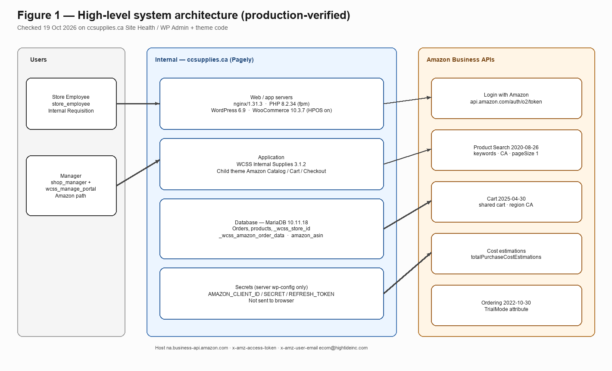
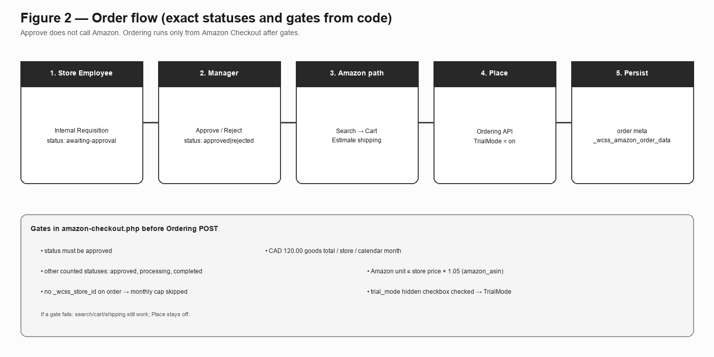
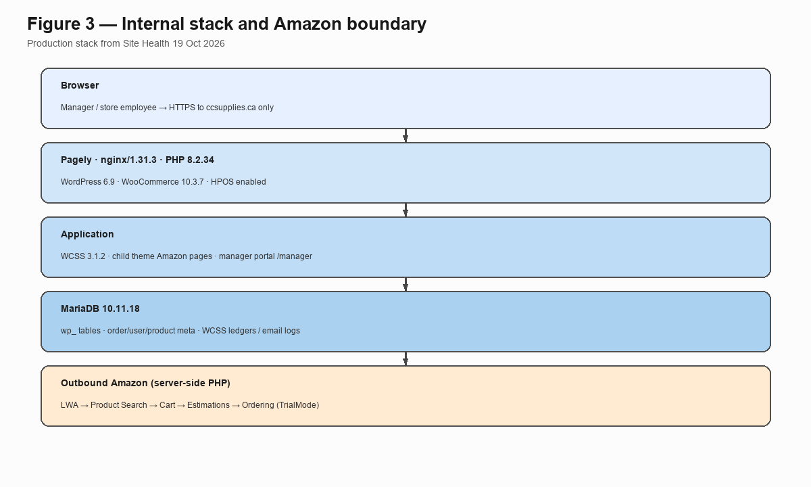

# High Tide — Amazon Business integration architecture

**Site:** https://ccsupplies.ca  
**Prepared by:** Usman Zahid (Basecamp Consulting)  
**For:** Jai Radhakrishnan / Ed Petrovacki — Amazon Business  
**Checked:** 19 October 2026 against production WP Admin (Site Health + WooCommerce Features) and the live theme/plugin code.  
**No credentials or secrets are in this document.**

---

## What this system does

ccsupplies.ca is High Tide’s internal stationery portal (Canna Cabana stores). Login required — not a public shop.

Verified flow in code + live manager UI:

1. **Store Employee** (`store_employee`) shops WooCommerce and checks out with payment method **Internal Requisition**. Order status becomes **Awaiting Approval**.
2. **Manager** (WordPress `shop_manager` with `wcss_manage_portal`, or administrator) opens `/manager/orders`, then **Approve** or **Reject**. Approve only changes WooCommerce status. It does **not** call Amazon.
3. After **Approved**, manager uses **Amazon Test Order** → Amazon Catalog → Search Amazon → Add to Amazon Cart → Amazon Cart → Amazon Checkout → Calculate Shipping → Place (still **Trial Mode**).

---

## Figure 1 — High-level system architecture

**Verified on production Site Health / admin (19 Oct 2026):**

| Item | Exact value |
| --- | --- |
| Hosting | Pagely (toolbar: Pagely®, PressCDN™, PressCACHE™) |
| Web server | nginx/1.31.3 |
| PHP | 8.2.34 (fpm-fcgi) |
| Database | MariaDB 10.11.18 (`mysqli` / mysqlnd 8.2.34), host localhost socket, table prefix `wp_` |
| WordPress | 6.9 |
| WooCommerce | 10.3.7 |
| Order storage | High-performance order storage (HPOS) **enabled** (`woocommerce_custom_orders_table_enabled` = yes) |
| Active theme | Adex360 X Canna Cabana Stationery Child 1.0.6 (parent: Adex360 X Canna Cabana Stationery) |
| Amazon + supplies plugin | WCSS – Internal Supplies for WooCommerce 3.1.2 |
| Mail plugin | WP Mail SMTP 4.7.1 |

Amazon calls leave our PHP app over HTTPS to Amazon Business. LWA client id / secret / refresh token are defined in server `wp-config.php` (not in the browser).

---

## Figure 2 — Order flow

**Gates before Ordering API** (enforced in `amazon-checkout.php`, not only UI):

| Gate | Exact rule in code |
| --- | --- |
| Approval | Store order status must be `approved` |
| Monthly cap | Flat **CAD 120.00**. Uses line-item goods totals only (`get_total()` on line items — not tax/shipping). Counts other orders for the same `_wcss_store_id` in the current calendar month with status `approved`, `processing`, or `completed`, plus this order. If the order has **no** `_wcss_store_id`, the cap does not apply. |
| Price check | Amazon unit ≤ store product price × **1.05** (5%). Link is product meta `amazon_asin` set when the manager adds from catalog. |
| Trial Mode | Checkout has a hidden, **checked** `trial_mode` checkbox. When set, Ordering payload includes `attributeType: TrialMode`. |

If a gate fails: Search / cart / shipping can still run; **Place Amazon Order** stays blocked.

---

## Figure 3 — Internal stack and Amazon boundary

Users only hit ccsupplies.ca. Amazon credentials never go to the browser. Outbound Amazon traffic is server-side from PHP.

---

## Internal systems (exact)

| Piece | What is live |
| --- | --- |
| Web / app | Pagely → nginx → PHP 8.2 → WordPress 6.9 + WooCommerce 10.3.7 (HPOS on) |
| Business logic | WCSS Internal Supplies 3.1.2 — store CPT, `_wcss_store_id` mapping, `/manager` routes, Approve/Reject, email notices, Email Logs |
| Amazon UI + API code | Child theme page templates: Amazon Catalog (`amazon-apis-integration.php`), Amazon Cart (`amazon-cart.php`), Amazon Checkout (`amazon-checkout.php`) |
| Database | MariaDB 10.11.18 — WordPress/WooCommerce tables + WCSS tables + order/user/product meta |
| Mail | WP Mail SMTP 4.7.1 (plus WCSS Email Logs under WooCommerce) |
| Secrets | `AMAZON_CLIENT_ID`, `AMAZON_CLIENT_SECRET`, `AMAZON_REFRESH_TOKEN` in `wp-config.php` on the server |

Dev copy of the site is Local by Flywheel on developer machines. Production is https://ccsupplies.ca.

---

## Data we store (Amazon-related) — from code

| Where | What |
| --- | --- |
| WooCommerce orders | Requisitions; statuses include `awaiting-approval`, `approved`, `rejected` |
| Order meta `_wcss_amazon_order_data` | Cart / estimate / place snapshot, request IDs, timestamps (constant `WCSS_AMAZON_ORDER_META_KEY`) |
| Product meta `amazon_asin` | Set on Add to Amazon Cart; used for 5% check |
| User meta `_wcss_store_id` | Store assignment for the employee |
| Option `wcss_amazon_asin_titles` | ASIN → title map used by cart/checkout helpers |

Access tokens are requested from LWA when needed for a call. They are not written into `_wcss_amazon_order_data` as the long-lived secret store.

---

## Who does what (exact capabilities)

| Who | Role / cap | What they do | Amazon Product Search AJAX |
| --- | --- | --- | --- |
| Store employee | `store_employee` | Shop, Internal Requisition, My Account | Search AJAX returns 403 unless user has `manage_woocommerce` or `manage_options` |
| Manager | `shop_manager` + `wcss_manage_portal` (also admin) | `/manager/*`, Approve/Reject, Amazon Test Order path | Yes (managers with Woo manage caps) |
| API business user header | — | — | `x-amz-user-email: ecom@hightideinc.com` (hardcoded / `AMAZON_USER_EMAIL` in theme) |

Manager portal auth: `wcss_manage_portal` or `manage_options` (`class-routes-manager.php`). Store employee opening `/manager/` is redirected to My Account (live-checked earlier with `demostore`).

---

## Amazon APIs we call today (from theme code)

| Step | Exact call |
| --- | --- |
| Auth | `POST https://api.amazon.com/auth/o2/token` — `grant_type=refresh_token` + client id/secret/refresh token |
| Product Search | `GET https://na.business-api.amazon.com/products/2020-08-26/products` |
| Cart | `…/cart/2025-04-30/carts` and `…/carts/{cartId}/items?region=CA` |
| Cost estimate | `POST …/cart/2025-04-30/carts/{cartId}/totalPurchaseCostEstimations?region=CA` |
| Place | `POST https://na.business-api.amazon.com/ordering/2022-10-30/orders` |

**Product Search query params in production catalog code** (`wp_amazon_business_search_products` / Search Amazon uses `pageSize=1`):

- `keywords` = WooCommerce product **name**  
- `productRegion` = `CA`  
- `locale` = `en_US`  
- `facets` = `OFFERS,IMAGES`  
- `pageSize` = `1` (top match)  
- `category` = `OFFICE_PRODUCTS`

**Headers on Amazon calls:** `x-amz-access-token`, `x-amz-user-email` (`ecom@hightideinc.com`), `Accept: application/json`

**Shared cart ID in code:** `cart-wxXmutF5kiXGRb9J` (`AMAZON_CART_ID`), region `CA`.

**Ordering group id default in checkout:** `OrderingAPI5259590399` (`AMAZON_GROUP_ID`).

**Not implemented in the current search path:** `getProductsByAsins`. We use keyword Product Search only. ASIN-based Buy Box search is planned after Tomas provides ASINs (per Oct 14 Amazon recap).

---

## Security / monitoring (what exists in code today)

- LWA secrets only on server config.  
- Amazon HTTP from PHP, not from the browser.  
- Catalog **Search Amazon** AJAX: logged-in + `manage_woocommerce` or `manage_options` + nonce.  
- Cart / shipping / place: WordPress nonces (`amazon_cart_nonce`, `amazon_shipping_nonce`, `amazon_checkout_nonce`).  
- Ordering blocked in PHP until approval + CAD 120 + 5% pass.  
- We capture Amazon `x-amzn-requestid` on responses and keep the order meta snapshot; manager has **Amazon order view**. WooCommerce **Email Logs** for mail. No separate CloudWatch/SIEM app inside ccsupplies.

---

## Next steps already agreed with Amazon (Oct 14 recap email)

These are **planned** items from Ed/Jai — not already built unless noted:

| Item | Status in our build today |
| --- | --- |
| Email Jai Product Search method/params | Done (sent) |
| Move to ASIN-based search for curated catalog | Not built yet — waiting on ASINs |
| Encrypt stored tokens; secret rotation reminder (~180 days); order error alerts | Not built yet (go-live list) |
| Store-employee request flow demo on follow-up call | Process exists; demo when scheduled |
| Reject process with Chris (manager + Amazon rejects) | Process discussion — not a separate Amazon API |
| Reporting + Package Tracking APIs | Not built — after first live order |
| Turn Trial Mode off | Still on (hidden checked checkbox) until sign-off |

Out of current Amazon Ordering build: Concur invoice automation, returns UI, ink spend split outside CAD 120.

---

If you want any layer expanded with request/response samples (no secrets), say which API step.

Usman Zahid  
Basecamp Consulting — High Tide / ccsupplies.ca  
uzahid@basecampconsulting.co
