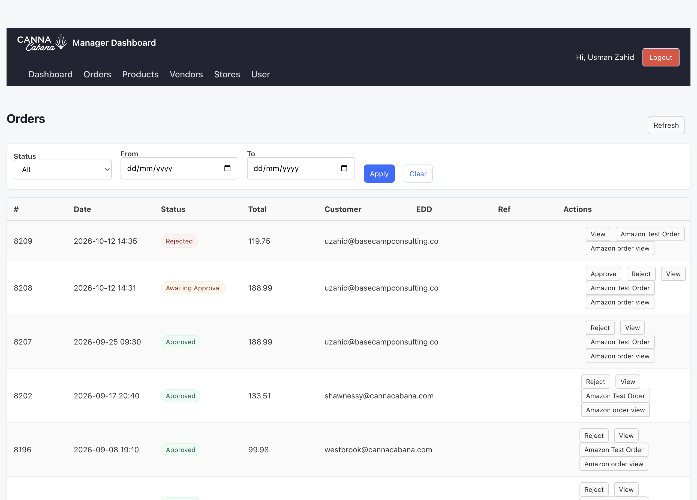
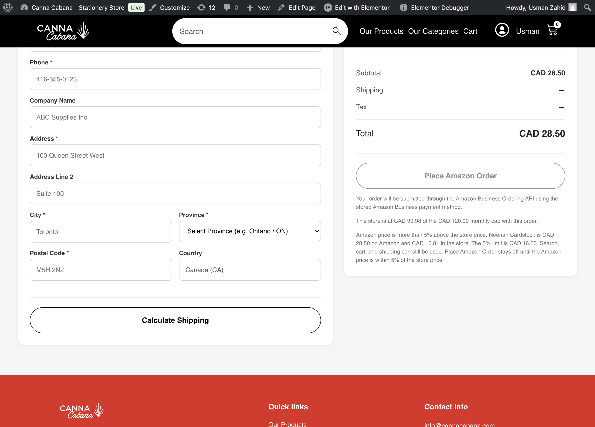
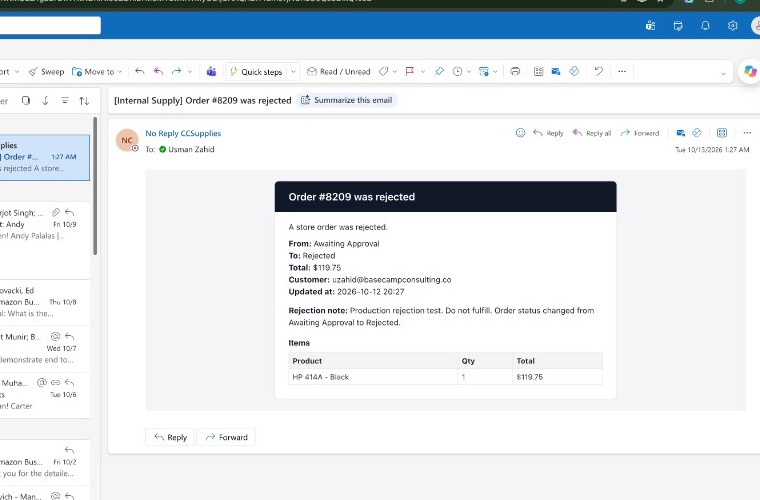
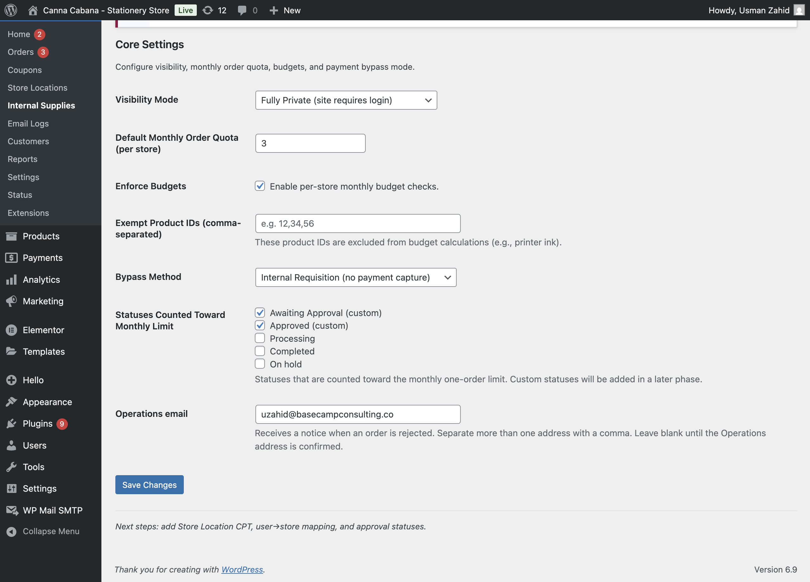

# Amazon ordering on [ccsupplies.ca](http://ccsupplies.ca)

Log in on ccsupplies.ca as someone who can manage orders. Leave Trial Mode on. Stop before the Place Amazon Order button. Pressing it would send a trial order to Amazon.

There is one Amazon cart for the whole site. The dollar amount on the right of checkout is that cart. The monthly cap uses the store order total instead. Those two numbers are different on purpose.

Checked on 13 October 2026.

## What was asked, and what we did

**1. Approval**

Asked: every store order needs a manager before anything is placed on Amazon. Nothing is auto approved under CAD 120.

Done: Approve on the manager orders page only changes the store order to Approved. It does not call Amazon. Place Amazon Order stays off until the status is exactly Approved. Search, the cart, and shipping still work before that.

**2. Catalog search**

Asked: search Amazon from our published store products. Do not open Amazon’s full catalog on the shop.

Done: the Amazon catalog page lists published store products. One letter does nothing. Two letters filter that list. Search Amazon returns the top Amazon match for that product. Add to Amazon Cart puts it in the shared cart and links that Amazon item to the store product.

**3. Monthly cap of CAD 120**

Asked: one flat cap of CAD 120 a month for each store. The old per store budget tiers are not used.

Done: the check adds this order’s goods total to that store’s other Approved, Processing, and Completed orders created in the current calendar month. Tax and shipping are not in the cap. Over CAD 120, Place Amazon Order stays off. Search, the cart, and shipping still work. An order with no store attached skips the cap.

**4. Price check of 5 percent**

Asked: if the Amazon unit price is more than 5 percent above the store price, do not place the order.

Done: each cart line is compared with the linked store product. Above the limit, Place Amazon Order stays off. A cheaper Amazon price is allowed. A price sitting on the limit is allowed. Search, the cart, and shipping still work.

**5. Rejection email**

Asked: when an order is rejected, tell the store that placed it, and tell Operations.

Done: Reject on the manager orders page sets the order to Rejected and sends the mail. The store message says your store order was rejected. The Operations message says a store order was rejected, and it is sent only when an address is saved in the field below. Shop managers still get the older status email they already receive.

## Where the orders are

Open the manager dashboard, then Orders.

8208 is Awaiting Approval. Use it for the approval block. Leave it there unless you mean to send the approval email.

8209 is Rejected. It was the rejection email test.

8196 is Approved, Westbrook, CAD 99.98. Use it for the under cap check.

8202 is Approved, Shawnessy, CAD 133.51. Use it for the over cap check.

8207 is Approved, no store, about CAD 188.99. The cap does not run. It already has a trial Amazon order. Do not place it again.

A newer Approved order for the same store in October changes the cap figure. The cap itself stays CAD 120.00.

## 1. Approval

Open Amazon checkout for order 8208.

The page says the order must be approved before it can be placed on Amazon, and it shows the current status.

Fill a Canadian address. This one has been used before: Usman Zahid, phone 416 555 0123, 100 Queen Street West, Toronto, Ontario, postal code M5H 2N2. The email on the form is already [ecom@hightideinc.com](mailto:ecom@hightideinc.com). Country stays Canada.

Click Calculate Shipping.

Shipping can still calculate. Place Amazon Order stays off, and the green line still says the order needs approval.

Question: does Approve send the Amazon order?

Answer: no. Approve only marks the store order Approved. Amazon is a later step, and only from checkout, and only while Trial Mode is on.

## 2. Catalog search

Open the Amazon catalog page on ccsupplies.ca.

Type one letter, for example n. The product list stays hidden.

Type ni. Store products whose name contains those letters appear.

Click Search Amazon on one row. One result comes back, with an ASIN, a CAD price, and Add to Amazon Cart. The Amazon title can differ from our title. That is the top match, not a bug.

Click Add to Amazon Cart. Then open the Amazon cart page. The same item is there.

Question: are shoppers browsing Amazon’s catalog?

Answer: no. We start from our published products and send the top Amazon match into the cart.

## 3. Monthly cap, order under CAD 120

Open Amazon checkout for order 8196. Leave the status Approved.

The note says this store is at CAD 99.98 of the CAD 120.00 monthly cap with this order. It must say “at”, not “over”. If October spend for Westbrook has changed, the first amount can differ. It must still name CAD 120.00.

The right side can show a small cart total, such as CAD 28.50. Ignore that number for the cap.

Place Amazon Order is off before shipping is calculated. That is normal.

If the 5 percent note is also on the page, Place stays off because of the price, even though this order is under the cap. Read the two notes separately. The screenshot below is that case: Westbrook is under the cap, and Neenah Cardstock is over the price limit, so the button stays off.

To see the button turn on, three things have to be true at once. The order is Approved. The store is at or under CAD 120. Every cart line is within 5 percent of the store price. Then fill the address, click Calculate Shipping, and wait for the line that says you can now place the order. The button turns dark. Stop there.

Situations:

The cart is empty. Calculate Shipping fails and the button stays off. Add one catalog item and try again.

Two cart items add up to more than CAD 120, while the store order is under CAD 120. The button can still turn on. The cap does not add cart lines.

The right side is under CAD 120 while the note says the store order is over the cap. The button stays off. The right side is the Amazon cart.

Question: why can a CAD 28.50 cart sit next to a CAD 99.98 cap note?

Answer: the cart is what would be sent to Amazon. The cap is the store’s own order total for the month.

## 4. Monthly cap, order over CAD 120

Open Amazon checkout for order 8202. Leave the status Approved. Use the same cart as the previous check.

The note names Shawnessy, says the store is over the CAD 120.00 monthly cap, and says this order is CAD 133.51. It also says search, the cart, and shipping can still be used, and Place stays off until the order fits the cap.

Fill the same address. Click Calculate Shipping. The green line repeats the over cap sentence. Place Amazon Order stays off.

Question: the cart total is small. Why is the button off?

Answer: this check uses the Shawnessy order total of CAD 133.51, not the cart on the right.

## 5. Order with no store

Open Amazon checkout for order 8207.

There is no sentence about the CAD 120.00 monthly cap, even though the store order is about CAD 188.99. The cap only runs when a store is attached.

This order already has a trial Amazon order from 9 October 2026. Amazon identifier 701 7666983 5405030. Do not place it again.

## 6. Price check of 5 percent

On 13 October 2026 the shared cart held Neenah Cardstock. Amazon price CAD 28.50. Store price CAD 15.81. The 5 percent limit is CAD 16.60. Checkout says the Amazon price is more than 5 percent above the store price, and Place Amazon Order stays off. That is the screenshot in section 3.

The link is created by Add to Amazon Cart. If a cart line was never added that way, the note says the 5 percent check could not be completed, and the button stays off.

Situations:

Amazon price is below the store price. Allowed.

Amazon price is exactly on the 5 percent limit. Allowed.

Amazon price is above that limit. Button stays off after Calculate Shipping. Search, the cart, and shipping still work.

The cart is empty. Shipping fails. That is not a price failure.

Question: can we raise the store price on the live site just to make this pass?

Answer: no. Use a real product whose Amazon price is already within 5 percent, or remove the line that fails.

## 7. Rejection email

The live test was order 8209 on 12 October 2026. It was Awaiting Approval. Reject was clicked on the manager orders page, with the note “Production rejection test. Do not fulfill.” The order is now Rejected, which is the first row in the orders screenshot above.

The Operations copy arrived from No Reply CCSupplies. Subject: [Internal Supply] Order #8209 was rejected. The body says a store order was rejected. The rejection note is in the email. WooCommerce also adds the line that the status changed from Awaiting Approval to Rejected.

The Operations address is saved here: WordPress admin, WooCommerce, Internal Supplies, field Operations email. More than one address can be separated with a comma. Save Changes after an edit.

The field currently holds [uzahid@basecampconsulting.co](mailto:uzahid@basecampconsulting.co) because that was the test inbox. Replace it with the confirmed Operations address before this is treated as the real setting. If the field is blank, no separate Operations email is sent. The store email and the manager email still go out.

To see the sent copy: WooCommerce, Email Logs. Find Order #8209 was rejected. The Operations row is marked as the operations notice.

To run the test again, use an order that is still Awaiting Approval, such as 8208. Only do that if the emails are acceptable. Reject sends real mail to the store, to the Operations address, and to the shop managers.

Question: why did shop managers get a second style of email?

Answer: they already get “status updated: Rejected” on every rejection. The new mail is the store wording and the Operations wording.

Question: does Reject place or cancel anything on Amazon?

Answer: no. It only rejects the store order and sends the notices.

## Still not in this build

Ink stays outside the CAD 120 cap. Chris asked for a separate High Tide discussion before that is built.

Package tracking waits for the first real Amazon order after Chris signs off.

Returns stay with Operations. There is no returns build.

The monthly invoice to Concur stays with Accounts Payable. Chris will take invoice review to them. The address he named is [invoicecapture@concursolutions.com](mailto:invoicecapture@concursolutions.com).